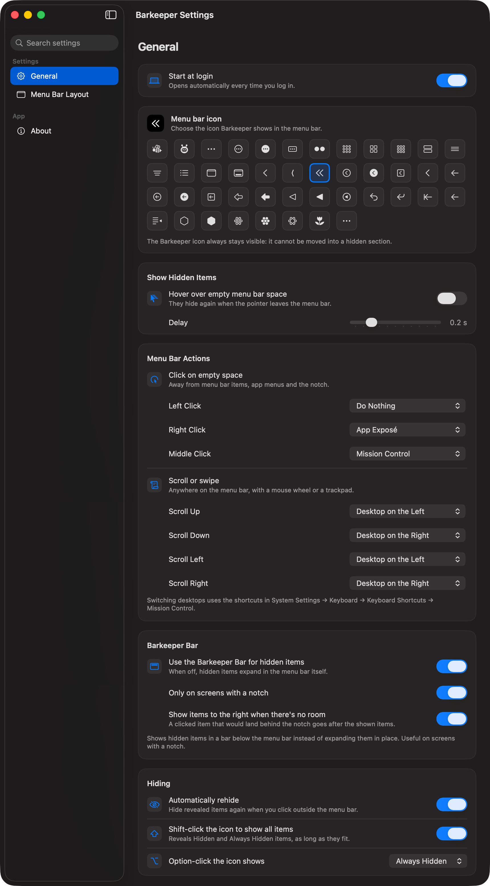
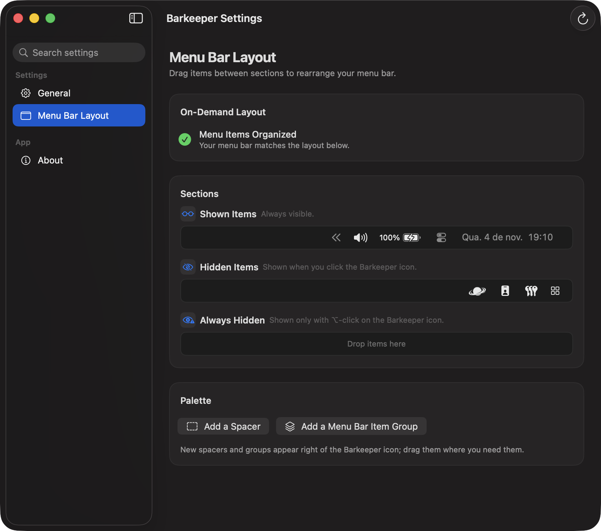

<p align="center">
  
</p>

<h1 align="center">Barkeeper</h1>

<p align="center"><b>Keeps your Mac's menu bar tidy.</b></p>
<p align="center">Hide, group and rearrange menu bar items, and reach hidden ones in a click.</p>

<p align="center">
  
  
  
</p>

---

Menu bars fill up fast, and on a MacBook with a notch, icons silently disappear behind it. Barkeeper
splits your menu bar into sections, keeps what you don't need out of sight, and brings it back
exactly when you want it. It's free and open source, with no account, no telemetry and no network
access.

<p align="center">
  
</p>

## Features

### Hide what you don't need
- **Three sections:** *Shown* (always visible), *Hidden* (revealed on demand) and *Always Hidden*
  (only with ⌥-click on the Barkeeper icon).
- **Click the Barkeeper icon** to reveal hidden items; ⇧-click shows everything.
- **Automatic rehide** when you click elsewhere or once an item's menu closes.
- The Barkeeper icon itself can never end up hidden.

### Arrange it visually
- **Menu Bar Layout:** drag items between sections and reorder them, and Barkeeper rearranges the
  real menu bar to match.
- **Organize Now** puts everything back where you saved it, including items of apps that were
  closed when you arranged them.
- **Spacers** to separate clusters of icons.
- **New apps stay visible:** when an app you've never used adds a menu bar item, it goes to *Shown*
  instead of disappearing.

<p align="center">
  
</p>

### Groups
- Bundle several items behind a single icon of your choice (SF Symbol or emoji, with an optional
  title). Click it, or just hover, to open the group in a small panel.

### The Barkeeper Bar
- Shows hidden items in a bar **below** the menu bar instead of expanding them in place, which is
  ideal on notched screens. You can turn it on only for screens with a notch.
- Clicking an item opens its real menu in place, without moving your pointer. Only that item
  appears in the menu bar.

### Menu bar actions
Give every gesture on the menu bar a job:

| Gesture | Where |
|---|---|
| Left, right and middle click | Empty menu bar space |
| Scroll / swipe up, down, left, right | Anywhere on the menu bar |
| Hover | Empty menu bar space (reveals hidden items, hides them when you leave) |

Available actions: show/hide hidden items, switch to the desktop on the left/right,
**Mission Control**, **App Exposé** and **Show Desktop**.

### And also
- Works across multiple displays and on notched MacBooks.
- Dozens of icons for the Barkeeper item, including a custom bee 🐝.
- Starts at login, if you want it to.
- One-click export of debug logs for bug reports.

## Requirements

- macOS 14 Sonoma or later (including macOS 26 Tahoe)

## Permissions

Barkeeper asks for two permissions in **System Settings → Privacy & Security**:

| Permission | Why | Required |
|---|---|---|
| **Accessibility** | To read, click and move menu bar items, and to react to clicks and scrolls on the menu bar. | Yes |
| **Screen Recording** | To show images of hidden items in Menu Bar Layout and in the Barkeeper Bar. Nothing is recorded or saved. | Optional |

Everything stays on your Mac. Barkeeper makes no network requests.

## Install

### Download

1. Download `Barkeeper.zip` from the [latest release](https://github.com/guigx7/Barkeeper/releases/latest),
   unzip it and move `Barkeeper.app` to `/Applications`.
2. Open it. Barkeeper isn't notarized yet, so macOS blocks the first launch:
   - Go to **System Settings → Privacy & Security**, scroll down and click **Open Anyway** next
     to the Barkeeper message, then confirm.
   - Or run this once in Terminal:

     ```sh
     xattr -dr com.apple.quarantine /Applications/Barkeeper.app
     ```
3. Grant the permissions Barkeeper asks for (see above).

> [!NOTE]
> Signed and notarized builds are planned. Until then, macOS may ask you to grant Accessibility
> again after updating to a new version.

### Build from source

Requires Xcode 16 or later and [XcodeGen](https://github.com/yonaskolb/XcodeGen).

```sh
brew install xcodegen
git clone https://github.com/guigx7/Barkeeper.git
cd Barkeeper
xcodegen generate
xcodebuild -project Barkeeper.xcodeproj -scheme Barkeeper -configuration Release -derivedDataPath build build
open build/Build/Products/Release/Barkeeper.app
```

## Development

- The Xcode project is generated by [XcodeGen](https://github.com/yonaskolb/XcodeGen) from
  [`project.yml`](project.yml) and is not checked in. Edit `project.yml`, not the `.xcodeproj`.
- `scripts/build.sh` builds a Debug copy into `build/`.
- Code layout:

  ```
  Barkeeper/
    App/        App lifecycle and wiring
    Platform/   WindowServer, Accessibility, event synthesis, displays, screen capture
    MenuBar/    Item scanning, control items, hiding, moving, layout, menu bar triggers
    Panel/      The Barkeeper Bar and opening hidden items
    Groups/     Menu bar item groups
    Settings/   Settings window (SwiftUI)
    Support/    Preferences, logging, log export
  ```

- Logs: `log stream --info --predicate 'subsystem == "br.tec.guigx.Barkeeper"'`.

## Contributing

Bug reports and pull requests are welcome. For bugs, please attach the debug log
(**Settings → About → Export Debug Logs…**) and tell us your macOS version and display setup.

## License

[MIT](LICENSE) © 2026 Guilherme Abdelnor "guigx7"
